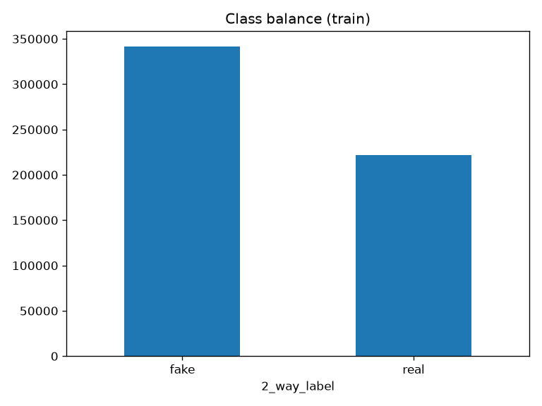
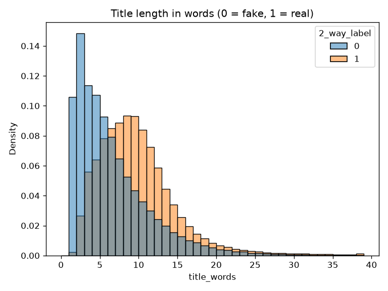
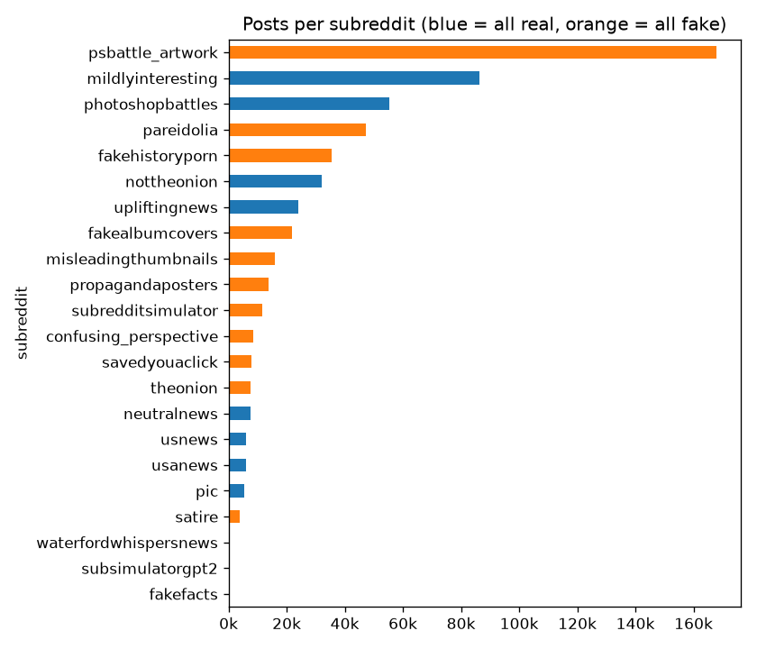
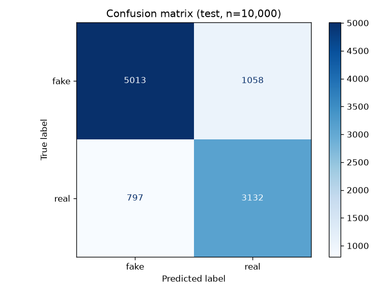
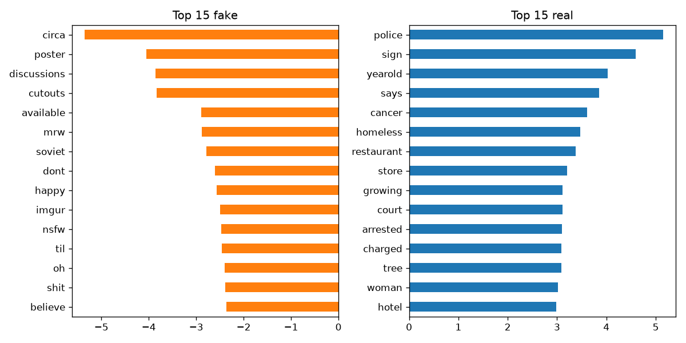

# Netikrų naujienų atpažinimas mašininio mokymosi modeliu

Kodas: [`notebooks/01_ml_model.ipynb`](../notebooks/01_ml_model.ipynb). Išsaugotas modelis: `models/logreg_tfidf.joblib`.

## 1. Darbo santrauka

Buvo sukurtas klasifikavimo modelis, kuris pagal Reddit įrašo antraštę ir tris įrašo statistikos skaičius nustato, ar įrašas tikras, ar netikras. Naudotas Fakeddit duomenų rinkinys, TF-IDF tekstui ir logistinė regresija. Modelis teisingai įvertino 81,5 % testo įrašų, kai vien spėjant „netikra“ būtų gauta 60,7 %.

## 2. Duomenų rinkinys

Fakeddit (Nakamura ir kt., 2020) yra Reddit įrašų rinkinys. Įrašo klasė priklauso nuo to, kuriame subreddit jis paskelbtas: pvz. įrašai iš *theonion*, *fakehistoryporn* ar *propagandaposters* laikomi netikrais, o iš *usnews*, *upliftingnews* ar *mildlyinteresting* - tikrais. Naudota multimodalinė dalis, t. y. tik įrašai su paveikslėliu, tačiau šiame darbe naudojamas tik tekstas ir skaičiai, ne paveikslėliai.

| Dalis | Failas | Įrašų |
|---|---|---|
| Mokymas | `multimodal_train.tsv` | 564 000 |
| Testas | `multimodal_test_public.tsv` | 59 319 |

Naudoti stulpeliai:

| Stulpelis | Reikšmė |
|---|---|
| `clean_title` | Įrašo antraštė mažosiomis raidėmis, be skyrybos ženklų |
| `score` | Teigiamų balsų skaičius minus neigiamų |
| `num_comments` | Komentarų skaičius |
| `upvote_ratio` | Kokia dalis balsų yra teigiami |
| `2_way_label` | Atsakymas: **0 = netikra, 1 = tikra** |

Ką parodė duomenų peržiūra:

- **Klasių santykis** - 60,6 % netikrų ir 39,4 % tikrų. Dėl to vien accuracy neužtenka, nes ir visada spėjant „netikra“ gaunama apie 61 %.
- **Antraštės ilgis** - netikros antraštės trumpesnės (mediana 5 žodžiai), tikros ilgesnės (mediana 9). Daug netikrų įrašų yra tiesiog trumpi paveikslėlių aprašai.
- **Subreddit** - iš 22 subreddit kiekvienas yra arba 100 % tikras, arba 100 % netikras, todėl klasę iš esmės nusako vien subreddit pavadinimas.
- **Trūkstamos reikšmės** - `num_comments` ir `upvote_ratio` trūksta 167 857 eilutėse (29,8 %), ir visos jos iš vieno netikro subreddit `psbattle_artwork`. Be to, `score` kartais būna neigiamas (mažiausias -236).

1. Klasių santykis mokymo duomenyse.

2. Antraštės ilgis žodžiais pagal klasę.

3. Įrašų skaičius kiekviename subreddit (mėlyna - visi tikri, oranžinė - visi netikri).

## 3. Duomenų paruošimas

1. **Įkelti tik reikalingi stulpeliai** - kompiuteris turi 16 GB RAM, todėl iš 16 stulpelių imama tik 6.
2. **Pašalinti stulpeliai** - `subreddit` pašalintas, nes jis tiesiog pasako atsakymą: su juo modelis gautų beveik 100 %, bet nieko neišmoktų apie tekstą. `author`, `id` ir `image_url` yra tik identifikatoriai, todėl net neįkeliami.
3. **Imtis** - atsitiktinai paimta 40 000 eilučių mokymui ir 10 000 testui (`random_state=42`) iš oficialių mokymo ir testo failų, todėl jos nepersidengia. Klasių santykis imtyse toks pat kaip pilnuose failuose.
4. **Tekstas** - `clean_title` paverstas TF-IDF vektoriais: imami pavieniai žodžiai ir žodžių poros, išmetami dažni angliški žodžiai (the, a, is...), žodžiai, pasitaikantys mažiau nei 2 antraštėse, taip pat išmetami. Liko 22 155 žodžiai ir frazės.
5. **Skaičiai** - `score`, `num_comments`, `upvote_ratio`: tušti langeliai užpildyti mediana, neigiami skaičiai pakeisti 0, pritaikytas `log1p` (nes `score` siekia 137 179, o mediana tik 14), tada visi skaičiai suvienodinti į panašų mastelį.
6. **Viena grandinė** - 4 ir 5 žingsniai sujungti su `ColumnTransformer` ir kartu su modeliu sudėti į vieną scikit-learn `Pipeline`. Taip žodynas, medianos ir masteliai skaičiuojami tik iš mokymo duomenų, o išsaugotam modeliui galima tiesiog paduoti naują įrašą.

## 4. Pasirinktas algoritmas

Naudota `LogisticRegression(class_weight="balanced", max_iter=1000)`.

Kodėl šis algoritmas:

1. **Tinka tekstui** - TF-IDF duoda dešimtis tūkstančių stulpelių, kuriuose dauguma reikšmių yra nuliai. Tiesiniai modeliai su tokiais duomenimis veikia gerai ir išmoksta per kelias sekundes.
2. **Galima paaiškinti** - kiekvienas žodis gauna vieną svorį, todėl matosi, kurie žodžiai stumia link „tikra“, o kurie link „netikra“ (5.3 skyrius). Netikrų naujienų atveju svarbu, kad vartotojas matytų, kodėl įrašas pažymėtas.
3. **Grąžina tikimybę** - jei praleista netikra naujiena kainuotų daugiau nei klaidingas pavojus, ribą galima pakeisti.
4. **Atsižvelgia į disbalansą** - `class_weight="balanced"` klaidas su retesne klase (tikros) vertina labiau, todėl modelis nepradeda visko vadinti „netikra“.
5. **Mažiau persimoko** - pagal nutylėjimą naudojama L2 reguliarizacija (`C=1.0`), todėl modelis per daug nepasikliauja retais žodžiais.

## 5. Rezultatai

### 5.1 Metrikos (testas, 10 000 įrašų)

| | Precision | Recall | F1 | Įrašų |
|---|---|---|---|---|
| Netikra | 0,863 | 0,826 | 0,844 | 6 071 |
| Tikra | 0,748 | 0,797 | 0,772 | 3 929 |
| Vidurkis (macro) | 0,805 | 0,811 | 0,808 | 10 000 |

**Accuracy - 81,5 %**, kai visada spėjant „netikra“ gaunama **60,7 %**.

### 5.2 Klaidų matrica

| | Spėta netikra | Spėta tikra |
|---|---|---|
| **Iš tikrųjų netikra** | 5 013 | 1 058 |
| **Iš tikrųjų tikra** | 797 | 3 132 |

4. Klaidų matrica testo duomenims.

Dažnesnė klaida - netikras įrašas palaikytas tikru (1 058, t. y. praleista 17 % netikrų įrašų).

### 5.3 Svarbiausi žodžiai

| Netikra | Svoris | Tikra | Svoris |
|---|---|---|---|
| circa | -5,35 | police | 5,15 |
| poster | -4,06 | sign | 4,59 |
| discussions | -3,86 | yearold | 4,02 |
| cutouts | -3,84 | says | 3,85 |
| available | -2,89 | cancer | 3,61 |
| mrw | -2,88 | homeless | 3,47 |
| soviet | -2,79 | restaurant | 3,38 |
| dont | -2,60 | store | 3,21 |
| happy | -2,57 | growing | 3,11 |
| imgur | -2,49 | court | 3,11 |
| nsfw | -2,47 | arrested | 3,10 |
| til | -2,46 | charged | 3,09 |
| oh | -2,40 | tree | 3,08 |
| shit | -2,38 | woman | 3,02 |
| believe | -2,37 | hotel | 2,99 |

5. 15 žodžių, labiausiai stumiančių link „netikra“ ir link „tikra“.

Skaičių svoriai: `num_comments` +0,77, `upvote_ratio` -0,64, `score` -0,21.

## 6. Pastebėjimai

- Modelis daugiausia išmoksta **ne tai, ar teiginys teisingas, o kaip rašoma tam tikrame subreddit**. Pvz. „circa“ ir „soviet“ ateina iš *fakehistoryporn*, „poster“ iš *propagandaposters*, „mrw“ ir „til“ iš memų antraščių. Tikros pusės žodžiai „police“, „arrested“, „court“, „charged“ yra tipiški naujienų antraštėms.
- Fakeddit klasės nustatytos pagal subreddit, ne pagal faktų tikrinimą, todėl geras rezultatas čia nereiškia, kad modelis gali patikrinti atskirą teiginį.
- Trūkstami komentarų skaičiai yra tik viename netikrame subreddit, todėl net užpildžius mediana skaičiai šiek tiek išduoda įrašo šaltinį.
- Naudota tik 40 000 iš 564 000 mokymo įrašų, o antraštės trumpos, todėl dalis įrašų turi labai mažai teksto, iš kurio galima ką nors spręsti.
- Modelis nemato paveikslėlių, nors daug netikrų įrašų yra netikri būtent dėl paveikslėlio.

## 7. Išvada

TF-IDF ir logistinės regresijos modelis pagal antraštę ir tris skaičius pasiekė 81,5 % accuracy ir 0,81 macro F1, t. y. apie 21 procentiniu punktu daugiau nei visada spėjant „netikra“. Vis dėlto modelis atpažįsta daugiau įrašo stilių („atrodo kaip memas ar satyra“ prieš „atrodo kaip naujienų antraštė“) nei tiesą, nes būtent tai ir vertina Fakeddit klasės. Kaip greitas ir paaiškinamas pirmas filtras jis tinka, bet teiginių tikrinimui jo neužtenka.
